# 우주마을(SPACE VILLAGE) PHASE 0 기획서

작성일 2026-11-12 · 이 파일은 Claude 문서로 쓴 기획서의 사본입니다. 그림은 PNG로 바꿔 넣었습니다.

## 1. 이번 PHASE 0 산출물

PHASE 0 결과물은 이 기획서, 브라우저에서 직접 움직여 볼 수 있는 [3D 시안](https://claude.ai/artifact/4V7KUd2HARmsBJSaYvSy75), 그리고 `tjdus7911-ops/universe` 저장소의 `phase0/planning` 브랜치 세 가지입니다. 승인하시면 PHASE 1을 시작합니다. 이번 단계에서는 서버·DB·계정을 만들지 않았고, 멍글마을 저장소와 서버는 읽기만 했습니다.

> **11-12 방향 변경:** 우주선에서 내리면 먼저 **달 착륙지**에 모이도록 바꿨습니다. 포장된 광장 없이 울퉁불퉁한 달 지형 위에서 친구들과 깡충 뛰고, 지평선 가까이 뜬 지구를 배경으로 단체 사진을 찍습니다. 우주 정거장은 없애지 않고, 달에서 우주선을 타고 가는 다음 공간으로 남겼습니다. 참고 화면은 이용자가 보내 준 플래시 게임 「달 기지」 화면(어두운 회갈색 지형, 바위 언덕, 빽빽한 별, 지평선 가까이 작은 지구)입니다.

| 요청 항목 | 어디에 있나 |
| --- | --- |
| 전체 기획 요약 · 기능 명세 · 화면 구조 · 플로우 | 이 문서 2\~5장 |
| 달 착륙지 3D 공간 시안 (우주선에서 내려 처음 만나는 곳) | 3D 시안 "달 기지 · 도착" 탭 (착륙 연출·점프·실험·단체 사진 작동), 이 문서 6·8·11장 |
| 우주 정거장 3D 공간 시안 · 지구 전망 장면 | 3D 시안 "정거장 · 지구 전망" 탭, 이 문서 6·11장 |
| 우주복 아바타 유영 장면 · 무중력 이동 방식 | 3D 시안 "우주 유영" 탭 (직접 조작 가능), 이 문서 7장 |
| 우주 탐험(행성 발견) · 행성 정보 화면 | 3D 시안 "우주 탐험 · 행성 발견"·"행성 정보" 탭 (직접 비행해 발견하고, 누르면 정보), 이 문서 8장 |
| 달 기지 라운지 (실내) | 3D 시안 "달 기지 라운지" 탭 (상점·탐험 도감 벽·우주선 꾸미기 코너·창가 소파), 이 문서 6장 |
| 우주 쓰레기 수거 미션 화면 | 3D 시안 "쓰레기 수거 미션" 탭 (수거·결과 화면까지 작동), 이 문서 9장 |
| PC 및 모바일 UI 시안 | 3D 시안 상단 "PC / 모바일" 전환, 이 문서 11장 |
| 기존 멍글마을 에셋 재활용 계획 | 이 문서 12장 |
| 신규 프로젝트 폴더 · 기술 구조 · 아키텍처 | 이 문서 13·14장, 저장소 |
| 데이터베이스 구조 | 이 문서 15장 |
| 개발 단계별 예상 작업량 | 이 문서 16장 |
| 서버 비용 및 무료 운영 가능성 | 이 문서 17장 |

### 3D 시안 보는 법

- 상단 탭에서 장면을 고릅니다. "모바일"을 누르면 같은 장면이 390×844 휴대폰 화면과 모바일 HUD로 바뀝니다. 휴대폰으로 열면 자동으로 모바일 화면이 됩니다.
- PC: W A S D 이동, 마우스 드래그 시점, 유영 중 Space·C 상하 이동, Shift 부스트, R 정거장 복귀, 미션에서 F를 길게 눌러 수거합니다.
- 달 착륙지: W A S D 걷기, Shift 깡충 달리기, Space 점프(착지 순간 다시 누르면 연속 점프, 3단부터 공중제비), 숫자 1\~7 감정 표현, E로 실험·단체 사진·월면차·망원경·우주선. 처음 들어가면 착륙 연출(약 10초)이 나오고, 오른쪽 위 "건너뛰기"로 넘길 수 있습니다.
- 우주 탐험: W A S D 비행, Space·C 위아래, Shift 부스트, 드래그 시점. 천체에 가까이 가면 발견되고, 발견한 천체를 누르면(또는 E) 정보가 열립니다. 화면 가장자리 노란 화살표가 아직 못 찾은 천체의 방향입니다.
- 모델은 전부 코드로 만든 시안용 임시 모델입니다. 완성본 에셋이 아니며, 서버·멀티플레이·저장은 동작하지 않습니다.

### 승인 체크리스트

- [ ] 달 착륙지의 지형·분위기가 참고 화면 방향과 맞는지 (울퉁불퉁한 땅, 바위 언덕, 빽빽한 별, 지평선 가까이 작은 지구)
- [ ] 정거장 전망창과 지구의 분위기·색감
- [ ] 우주복 아바타의 비율·귀여움·헬멧 표현
- [ ] 무중력 조작감 (속도·관성 보조·복귀 버튼)
- [ ] PC·모바일 HUD 배치
- [ ] 비회원 정책 B안 (10장)
- [ ] 서버 권장안 (17장): PHASE 4 전까지 0원, 이후 후보는 승인 후 계정 생성

## 2. 전체 기획 요약

우주마을은 귀여운 3D 아바타로 달과 우주 정거장에서 친구를 만나는 서비스입니다. 우주선에서 내리면 먼저 달 언덕에서 친구들과 만납니다. 이용자는 우주복을 입고 무중력으로 유영하고, NASA 자료 기반의 과학 지식을 몸으로 체험해 도감에 모읍니다. 멍글마을과는 저장소·서버·DB·계정이 완전히 분리된 신규 프로젝트입니다.

| 항목 | 내용 |
| --- | --- |
| 장르 | 3D 소셜 월드 · 우주 탐험 · 인터랙티브 과학 교육 · 캐주얼 미션 |
| 플랫폼 | PC 웹, 모바일 웹 (처음부터 PWA 설치가 가능한 구조) |
| 타깃 | 우주에 관심 있는 일반 이용자, 귀여운 소셜 게임 이용자, 우주 과학을 쉽게 배우고 싶은 이용자 |
| 핵심 차별점 | 우주를 "보는" 서비스가 아니라 우주 속에서 직접 움직이고 배우는 서비스 |
| 아트 방향 | 고품질 스타일라이즈드 3D: 정거장 안은 따뜻하고 친근하게, 우주 밖은 웅장하고 신비롭게 |

### 핵심 경험 10단계

1. 지구 우주항에서 우주선을 타고 출발한다 (첫 방문만 연출, 재방문은 건너뛰기).
2. 달에 착륙해 해치를 열고 첫발을 내딛는다. 첫 발자국에 표시가 남는다.
3. 달 착륙지에서 먼저 온 친구들과 만나 연속 점프·감정 표현으로 놀고, 같이 채팅한다.
4. 지평선 가까이 뜬 지구를 배경으로 단체 사진을 찍고, 망치·깃털 실험을 해 본다.
5. 우주선을 타고 궤도 정거장으로 가서 거대한 지구를 내려다본다.
6. 우주복을 입고 에어록을 지나 무중력 상태로 유영한다 (게임형 추진기 조작).
7. 우주선을 몰고 행성에 가까이 가서 발견하고, 발견한 행성을 눌러 실제 과학 정보를 확인한다.
8. 우주 쓰레기를 수거하고 탐험 미션을 수행한다.
9. 발견한 정보를 탐험 도감에 저장한다.
10. 스타코인으로 아바타와 개인 우주선을 꾸민다.

### 과학 정보와 게임 연출을 구분하는 4가지 원칙

- **숫자에는 항상 단위·기준·출처·검증일을 붙인다.** 예: "적도 표면 중력 3.7 m/s² · NASA Planetary Fact Sheet · 2026-11-12 검증".
- **축척을 바꾼 화면에는 배지를 단다.** 우주 탐험 화면에는 "교육용 축척 표현 — 실제 크기·거리 비율과 다름"을 항상 표시한다.
- **게임 규칙에는 "게임 연출" 표시를 단다.** 정거장 인공중력, 손으로 줍는 쓰레기 수거, 추진기 조작감은 실제와 다르다는 안내 카드를 함께 보여 준다.
- **실제로 불가능한 체험은 만들지 않는다.** 목성·토성·천왕성·해왕성은 단단한 지표면이 없으므로 착륙 대신 궤도 관측 콘텐츠로만 구성한다.

## 3. 전체 기능 명세서

MVP는 PHASE 1\~4의 "필수" 기능입니다. 즉 정거장·유영·행성 교육·쓰레기 미션·코인·로그인·채팅·멀티플레이까지입니다. "권장"은 같은 PHASE 안에서 여유가 있을 때 넣고, "후순위"는 출시 뒤로 미룹니다.

| 영역 | 기능 | 우선순위 | PHASE |
| --- | --- | --- | --- |
| 공통 | 시작 화면, 로그인·회원가입, 비회원 둘러보기 진입 | 필수 | 1 (계정은 4) |
| 공통 | 아바타 선택(프리셋 4종 + 색상), 우주복 색상 선택 | 필수 | 1 |
| 공통 | 설정: 그래픽 품질(자동/저/중/고), 사운드, 카메라 반전, 연출 건너뛰기 | 필수 | 1 |
| 지구 우주항 | 출발 게이트, 탑승 연출(첫 방문 1회, 재방문 건너뛰기) | 필수 | 1 |
| 달 착륙지 | 착륙 연출(약 10초, 건너뛰기), 저중력 보행·점프(1.62 m/s²)·깡충 달리기, 사라지지 않는 발자국, 포물선으로 떨어지는 먼지 | 필수 | 1 |
| 달 착륙지 | 망치·깃털 낙하 실험, 언덕 위 단체 사진(폴라로이드), 지구 크기 연출↔실제 전환, 달 과학 노트 | 필수 | 1\~2 |
| 달 착륙지 | 연속 점프(최대 4단, "게임 보너스" 표시)·공중제비, 감정 표현 7종, 월면차 운전(포물선 흙먼지), 망원경으로 지구 보기 | 필수 | 1\~2 |
| 라운지 | 실내 입장·퇴장, 우주복 상점(보유 색상 바로 입기), 탐험 도감 벽, 우주선 꾸미기 코너, 창가 소파 | 필수 | 1 (공간) · 3\~5 (구매·꾸미기) |
| 정거장 | 중앙 소셜 광장, 거대한 지구 전망창, 인공중력 보행 이동 | 필수 | 1 |
| 정거장 | 행성 관측실, 미션 게시판, 우주 유영 출입구(에어록), 우주선 탑승장 | 필수 | 1\~3 |
| 정거장 | 광고 전광판 3곳(광장·탑승장·관측실) | 필수 | 5 |
| 우주 유영 | 무중력 6방향 이동, 추진기 부스트, 부드러운 가감속, 부유 애니메이션, 추진기 입자 | 필수 | 1 |
| 우주 유영 | 안전: 정거장 복귀 버튼, 이동 반경 제한, 길 잃음 안내, 카메라 롤 고정 | 필수 | 1 |
| 우주 탐험 | 우주선 비행, 가까이 가면 천체 발견, 발견한 천체를 누르면 정보, 미확인 신호 화살표, 교육용 축척 표기 | 필수 | 2 |
| 행성 정보 | 행성 상세 패널(3D 모델·기본 수치·지구 비교·흥미로운 사실·출처) | 필수 | 2 |
| 중력 체험 | 지구·달·화성 점프 비교(같은 초기 속도), 체험 후 퀴즈 | 필수 | 2 |
| 탐험 도감 | 방문·발견 천체, 완료 미션, 학습한 지식, 배지, 기념품 (서버 저장) | 필수 | 2\~3 |
| 미션 | 우주 쓰레기 수거(탐색·접근·수거·결과·과학 카드) | 필수 | 3 |
| 미션 | 일일 미션 3개(한국 시간 0시 갱신), 탐험 배지 | 필수 | 3 |
| 경제 | 스타코인 적립·사용, 보상 내역, 서버 검증·중복 방지·음수 방지 | 필수 | 3 |
| 경제 | 상점: 우주복 색상, 액세서리, 추진기 이펙트 | 권장 | 3 |
| 소셜 | 회원 계정(아이디·비밀번호), 프로필, 닉네임 | 필수 | 4 |
| 소셜 | 실시간 아바타 동기화, 채널 인원 제한, 재접속 복구 | 필수 | 4 |
| 소셜 | 채팅(공간 채팅 + 말풍선), 친구 추가·목록·따라가기 | 필수 | 4 |
| 소셜 | 신고·차단, 욕설·도배 필터 | 필수 | 4 |
| 소셜 | 1:1 메시지, 감정 표현 | 후순위 | 6 이후 |
| 개인 우주선 | 소형 우주선 1종, 내부 입장, 가구 배치·회전·교체, 벽면 장식, 기념품 전시, 저장 | 필수 | 5 |
| 개인 우주선 | 중형·대형 우주선, 친구 우주선 방문 | 후순위 | 6 이후 |
| 운영 | 관리자 로그인·권한 분리, 회원 관리·이용 정지, 신고 처리 | 필수 | 5 |
| 운영 | 광고판 승인, 미션·행성 정보·공지 관리, 운영 로그 | 필수 | 5 |
| 운영 | 실제 결제 | 제외 | 초기 미구현 |

모든 보상·위치·관리자 요청은 서버에서 다시 검증합니다. 클라이언트가 보낸 값은 "요청"으로만 취급합니다.

## 4. 서비스 화면 구조도

달 착륙지(7번)가 처음 도착하는 허브이고, 정거장 메인(11번)은 우주선을 타고 가는 두 번째 허브입니다. 탐험·성장 영역의 화면은 두 허브의 3D 오브젝트나 HUD 버튼에서 열립니다. 모든 화면에는 뒤로가기와 허브 복귀 버튼이 있습니다.

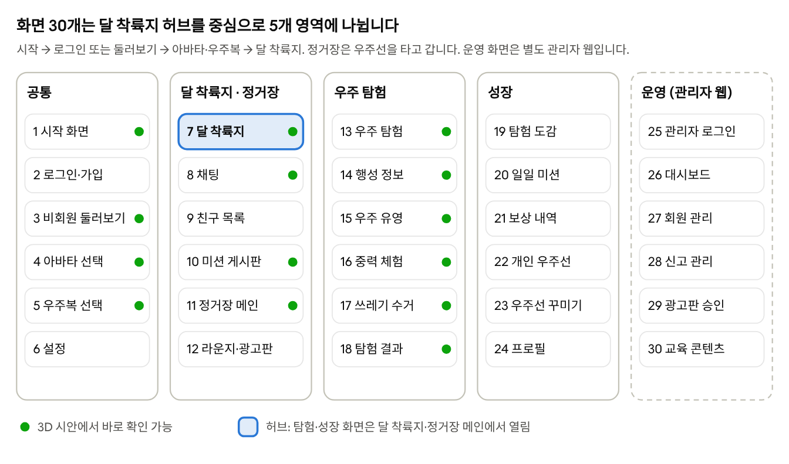

모바일에서는 채팅·친구·도감을 하단 버튼과 더보기 시트로 모읍니다. 3D 화면을 가리는 패널은 한 번에 하나만 엽니다.

## 5. 주요 사용자 플로우

여섯 플로우 모두 어느 단계에서나 처음 허브(달 착륙지 또는 정거장)로 돌아갈 수 있습니다. 괄호 안은 서버가 확인하는 내용입니다.

### A. 최초 방문

1. 시작 화면
2. 회원가입 또는 둘러보기 (게스트 세션 발급)
3. 아바타 선택
4. 우주복 착용 (색상 선택)
5. 우주선 탑승 → 달 착륙 연출 약 10초 (건너뛰기 버튼 항상 표시)
6. 해치에서 첫발 → 달 착륙지 도착 (빈 자리가 있는 채널 자동 배정)
7. 첫 안내: "Space로 점프해 보세요" → 언덕 위 단체 사진·망치깃털 실험 안내
8. 우주선을 다시 타면 궤도 정거장 (지구 전망·우주 유영)

### B. 행성 탐험

1. 달 착륙지에서 달마중호에 타고 "우주 탐험" 선택
2. 화면 가장자리 신호 화살표를 따라 비행 (교육용 축척 배지 상시 표시)
3. 천체 가까이 가면 "새 천체 발견!" (서버가 우주선 위치와 천체 거리를 확인)
4. 발견한 천체를 누르기 → 행성 정보 패널
5. 체험하기 (지구·달·화성은 중력 체험, 가스행성은 궤도 관측)
6. 도감 저장 (회원만 영구 저장, 비회원은 이번 접속에서만 유지)
7. 달 착륙지로 복귀

### C. 무중력 체험

1. 정거장 우주 유영 출입구
2. 우주복 확인 (헬멧·추진기 장착 애니메이션)
3. 에어록 감압 연출 → 우주 외부 이동
4. 무중력 조작 안내 (첫 1회)
5. 지구 관측 (지구를 누르면 정보 카드)
6. 정거장 복귀 (버튼 또는 에어록 진입)

### D. 우주 쓰레기 수거

1. 미션 게시판에서 수거 미션 수락 (서버가 미션 회차 생성)
2. 우주 유영 구역으로 이동
3. 목표물 탐색 (화면 표식 + 거리 표시)
4. 3 m 안으로 접근 → 수거 버튼을 1.2초 누르기 (서버가 거리·상태 검증)
5. 결과 화면 (수거 개수, 소요 시간)
6. 보상 지급 (서버 거래 1건, 중복 지급 불가)
7. 도감 기록 + 우주 쓰레기 과학 카드

### E. 친구와 탐험

1. 친구 목록
2. 친구 위치 확인 (친구가 위치 공개를 켜 둔 경우만)
3. 따라가기 (같은 공간·채널에 자리가 있는지 서버 확인)
4. 같은 정거장 또는 탐험 공간 접속
5. 함께 이동·채팅

채널이 가득 찼으면 "친구와 같은 채널 대기" 또는 새 채널 함께 이동을 제안합니다.

### F. 우주선 꾸미기

1. 개인 우주선 입장
2. 꾸미기 모드
3. 가구 선택 (보유 아이템만)
4. 배치·회전 (격자 스냅, 겹침·범위 밖 배치 불가)
5. 저장 (서버가 소유·개수·좌표 검증)
6. 일반 모드 복귀

## 6. 3D 공간 구성도

우주마을은 여덟 개의 3D 공간으로 이루어집니다. 우주선에서 내려 처음 만나는 곳은 달 착륙지이고, 기지 돔 안의 라운지와 우주선으로 가는 우주 탐험·정거장이 여기서 이어집니다. 정거장 중앙 광장은 두 번째 허브입니다. 달 착륙지는 어두운 회갈색 흙과 바위 언덕, 빽빽한 별 아래에서 지구가 지평선 가까이 작게 떠 있는 실제 달의 분위기로 만듭니다. 정거장 안은 따뜻한 조명과 파스텔 포인트 색을 쓰고, 창밖은 깊은 남색 우주와 지구의 대기 빛으로 웅장하게 대비합니다.

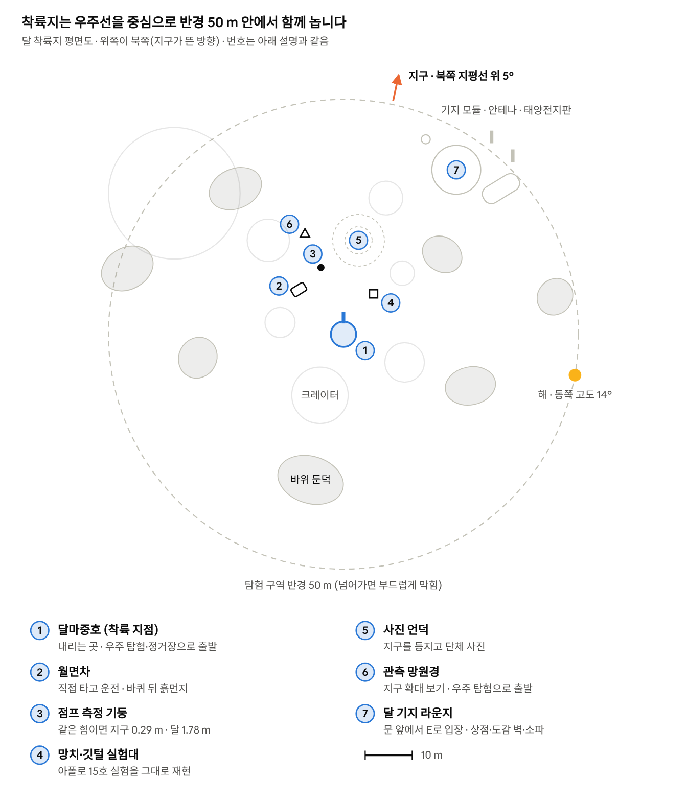

착륙 지점에서 북쪽(지구 방향)으로 걸어 나가면 점프 기둥·실험대·사진 언덕이 차례로 나오고, 북동쪽 언덕 위에 기지 돔이 보입니다. 포장된 광장은 두지 않고, 구조물 밑만 흙을 살짝 고릅니다. 아래는 두 번째 허브인 정거장 광장입니다.

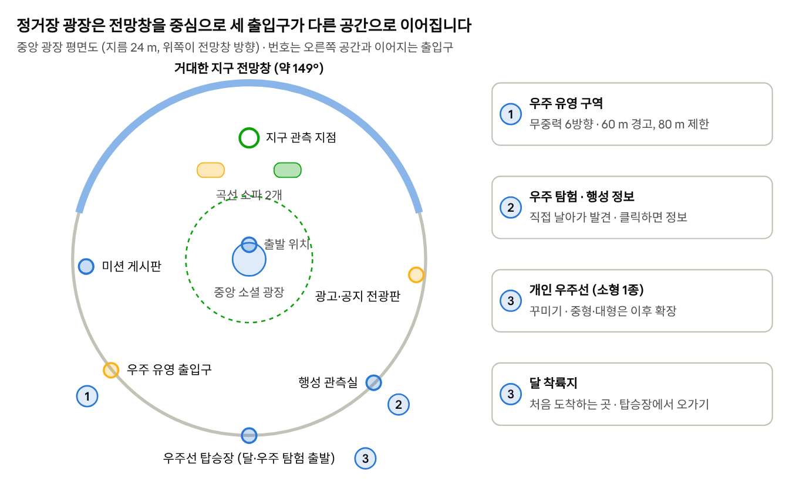

| 공간 | 이동 방식 | 크기·경계 | 핵심 오브젝트 | PHASE |
| --- | --- | --- | --- | --- |
| 달 착륙지 | 저중력 보행·점프·깡충 달리기 (1.62 m/s²) | 착륙 지점 기준 반경 50 m, 채널당 20\~30명 목표 | 달마중호(착륙선), 월면차, 점프 측정 기둥, 망치·깃털 실험대, 사진 언덕, 망원경, 언덕 위 기지 돔, 바위 둔덕 | 1 |
| 달 기지 라운지 (실내) | 저중력 보행 | 지름 19 m 원형 돔 | 로봇 점원 상점, 탐험 도감 벽, 우주선 꾸미기 코너, 창가 소파, 창밖 달 풍경 | 1 |
| 지구 우주항 | 연출(조작 없음) | 장면 1개 | 출발 게이트, 아바타 착용대, 우주선 | 1 |
| 정거장 중앙 광장 | 인공중력 보행 | 지름 24 m, 채널당 20\~30명 목표 | 전망창, 소파, 미션 게시판, 전광판, 에어록, 관측실 표지 | 1 |
| 우주 유영 구역 | 무중력 6방향 | 에어록 기준 반경 80 m | 정거장 외벽(거주 링·허브·태양전지판), 인공위성, 쓰레기, 지구 | 1, 3 |
| 우주 탐험 구역 | 우주선 비행 (부스트) | 교육용 축척 (태양에서 해왕성까지 약 2,000 게임 단위) | 태양, 8행성, 달, 소행성대, 궤도선, 미확인 신호 화살표, 교육용 축척 배지 | 2 |
| 중력 체험실 | 점프 비교 | 지구·달·화성 세 레인 | 높이 눈금자, 최고 높이 표시선 | 2 |
| 개인 우주선 | 실내 보행 + 꾸미기 모드 | 소형 1종 (격자 배치) | 가구, 벽면 장식, 우주 사진 액자, 기념품 진열대 | 5 |

성능 원칙도 공간별로 정합니다. 지구·별·은하수는 카메라를 따라다니는 하늘 구로 그립니다. 반복되는 화분·태양전지판은 인스턴싱으로 묶습니다. 모바일은 그림자 해상도와 블룸을 낮춘 '중' 품질로 시작합니다.

달 지형은 착륙 지점을 중심으로 가까울수록 촘촘한(0.45 m) 극좌표 격자 한 덩어리로 지평선(약 3 km)까지 그립니다. 자갈·바위 약 1천 개는 인스턴싱 한 번으로 그리고, 발자국은 최근 1,100개까지 남기며 오래된 것부터 지웁니다. 먼지 입자는 공기 저항 없이 달 중력만 받아 포물선으로 떨어집니다.

## 7. 무중력 이동 방식

무중력 이동은 실제 관성 물리 대신 조작이 쉬운 게임형 모델을 씁니다. 입력이 있으면 가속하고, 입력이 없으면 "관성 보조"로 천천히 멈춥니다. 실제 우주에는 공기 저항이 없어 한 번 밀면 계속 떠갑니다. 이 차이는 첫 유영 때 안내 카드로 알려 줍니다.

### 조작

| 동작 | PC | 모바일 |
| --- | --- | --- |
| 전후좌우 이동 | W A S D (카메라 방향 기준) | 왼쪽 아래 가상 조이스틱 |
| 위로 / 아래로 | Space · E / C · Q | 오른쪽 ▲ ▼ 버튼 (누르고 있는 동안) |
| 추진기 부스트 | Shift | 부스트 버튼 |
| 카메라 회전 | 마우스 드래그 | 빈 화면 한 손가락 드래그 |
| 확대·축소 | 마우스 휠 | 두 손가락 핀치 |
| 정거장 복귀 | R 또는 복귀 버튼 | 복귀 버튼 (상단 오른쪽 고정) |
| 수거·상호작용 | F (길게 누르기) | 수거 버튼 (길게 누르기) |

모바일은 조이스틱을 누른 채 다른 손가락으로 버튼을 누를 수 있게 포인터를 따로 추적합니다. 버튼은 최소 48 px, 자이로 조작은 기본 끕니다.

### 이동 모델 (시안 기준값, 플레이테스트로 조정)

| 항목 | 값 | 이유 |
| --- | --- | --- |
| 기본 최고 속도 | 3.0 m/s | 정거장 모듈 사이를 습관적으로 제어할 수 있는 속도 |
| 부스트 최고 속도 | 6.0 m/s, 최대 3초, 2초 뒤 충전 | 탐색 시간 단축, 무한 가속 방지 |
| 가속도 | 4.0 m/s² (부스트 8.0) | 출발은 부드럽게, 반응은 즉각적으로 |
| 관성 보조(자동 감속) | 입력 없을 때 시간상수 0.6초로 감속 | 게임 보정 — 실제 우주에서는 감속하지 않음 |
| 기준 위쪽 | 정거장의 위쪽으로 고정 | 어느 쪽이 위인지 혼란 방지 |
| 카메라 | 수평 360°, 상하 ±70° 제한, 롤 0° 고정 | 카메라 이상 회전·멀미 방지 |
| 아바타 방향 | 이동 방향으로 부드럽게 회전, 정지 시 부유 대기 포즈 | 자연스러운 유영 느낌 |
| 추진기 입자 | 가속 반대 방향으로 분사, 부스트 시 2배 | 움직임을 눈으로 읽게 함 |

### 안전 기능

- **정거장 복귀**: 버튼을 누르면 에어록까지 자동 활주합니다(4\~6초). 40 m 이상 떨어져 있으면 화면 전환 후 에어록 앞에 도착합니다.
- **이동 반경 제한**: 에어록 기준 60 m부터 부드러운 반발력과 경고 링이 나타나고, 80 m에서 더 나가지 않습니다.
- **길 잃음 방지**: 정거장이 8초 이상 화면 밖에 있으면 정거장 방향 화살표와 복귀 버튼 깜빡임을 보여 줍니다.
- **충돌**: 정거장 모듈은 단순화한 구·캡슐 충돌체로 막아 아바타가 벽을 통과하지 않게 합니다.
- **서버 검증**: 멀티플레이에서는 속도가 부스트 최고치의 1.2배를 넘거나 80 m 밖이면 서버가 위치를 보정합니다.

## 8. 행성 정보·중력 체험 콘텐츠 기준

행성 수치는 값마다 단위·기준·출처·검증일을 함께 저장합니다. 기본 출처는 [NASA NSSDCA Planetary Fact Sheet](https://nssdc.gsfc.nasa.gov/planetary/factsheet/index.html)(2025-03-18 갱신)입니다. 같은 NASA 자료 안에서도 값이 어긋납니다. 화성 평균 기온은 표에서 −65 °C인데, [화성 상세 시트](https://nssdc.gsfc.nasa.gov/planetary/factsheet/marsfact.html?embed=true)(2025-05-19)에서는 약 −59 °C입니다. 그래서 항목마다 출처를 하나로 정하고 그 기준을 표시합니다.

### 표시 항목과 기준

| 항목 | 화면 표시 예 | 기준·주의 |
| --- | --- | --- |
| 이름 | 화성 Mars | 한국어 + 영어 |
| 분류 | 암석형 행성 | 항성 / 암석형 / 가스 거대 / 얼음 거대 / 위성 |
| 태양으로부터 거리 | 2억 2,800만 km | 평균 거리(장반경)임을 표시. 달은 "지구로부터" |
| 지름 | 6,792 km | 적도 지름 |
| 중력 | 3.7 m/s² (지구의 0.38배) | 적도 표면, 자전 효과 포함. 가스행성은 1 bar 고도 |
| 기온 | 평균 −65 °C | 평균과 범위를 별도 필드로. 범위는 "낮 최고 / 밤 최저"처럼 따로 표기 |
| 대기 | 이산화탄소 95% | 주요 기체 부피비 |
| 자전 주기 | 24.6시간 | 항성 기준 자전. "하루 길이"(태양일)는 별도 항목 |
| 공전 주기 | 687일 | 지구일 기준 |
| 주요 특징·흥미로운 이야기 | 최대 3개 | 문장마다 출처 링크 |
| 관련 미션 | 화성 중력 점프 체험 | 가스행성은 "궤도 관측" 미션만 |

### 기준 수치

아래 표는 NASA 표의 값입니다. 평균 기온은 가스·얼음 거대 행성의 경우 1 bar 고도 기준입니다.

| 천체 | 지름 (km) | 태양까지 평균 거리 (10⁶ km) | 중력 (m/s²) | 평균 기온 (°C) | 자전 주기 (시간) | 공전 주기 (일) |
| --- | --- | --- | --- | --- | --- | --- |
| 수성 | 4,879 | 57.9 | 3.7 | 167 | 1,407.6 | 88.0 |
| 금성 | 12,104 | 108.2 | 8.9 | 464 | −5,832.5 (역방향) | 224.7 |
| 지구 | 12,756 | 149.6 | 9.8 | 15 | 23.9 | 365.2 |
| 달 | 3,475 | 0.384 (지구까지) | 1.6 | −20 | 655.7 | 27.3 (지구 둘레) |
| 화성 | 6,792 | 228.0 | 3.7 | −65 | 24.6 | 687.0 |
| 목성 | 142,984 | 778.5 | 23.1 | −110 | 9.9 | 4,331 |
| 토성 | 120,536 | 1,432.0 | 9.0 | −140 | 10.7 | 10,747 |
| 천왕성 | 51,118 | 2,867.0 | 8.7 | −195 | −17.2 (역방향) | 30,589 |
| 해왕성 | 49,528 | 4,515.0 | 11.0 | −200 | 16.1 | 59,800 |

태양은 항성이라 별도 항목으로 두고, [NASA Sun Fact Sheet](https://nssdc.gsfc.nasa.gov/planetary/factsheet/sunfact.html?level=1)의 적도 표면 중력 274.0 m/s² 등을 씁니다. 달의 기온은 평균보다 범위가 더 중요합니다. NASA LRO 관측 기준으로 적도 부근은 낮 약 120 °C, 밤 약 −130 °C입니다([NASA LRO](https://science.nasa.gov/wp-content/uploads/2024/01/lrolitho7temperaturevariation27may2014.pdf)). 수성도 낮 최고 430 °C, 밤 최저 −180 °C를 범위로 함께 보여 줍니다([NASA Mercury Facts](https://science.nasa.gov/mercury/facts)).

위성 수는 새 발견으로 자주 바뀝니다. NASA 표는 천왕성 28개인데, 2025년 8월 웹 망원경이 29번째 위성을 발견했다는 보도가 있습니다. 그래서 위성 수는 "변동 잦음" 항목으로 분류하고 3개월마다 다시 확인합니다. 나머지 값은 6개월마다 확인합니다.

### 축척 표기

우주 탐험 구역은 행성 크기와 거리를 크게 줄여서 몇 분 안에 모든 천체를 찾아갈 수 있게 했습니다(태양 반지름 70, 지구까지 510, 해왕성까지 1,980 게임 단위). 화면 상단에는 "교육용 축척 — 실제 거리·크기와 많이 달라요" 배지를 항상 띄웁니다. 행성 정보 패널은 실제 지름·중력을 지구와 비교하는 막대를 보여 줍니다. 소행성대를 지날 때는 실제 소행성대가 이렇게 빽빽하지 않다는 안내를 "게임 연출" 표시와 함께 띄웁니다.

### 중력 체험 계산

세 천체에서 같은 초기 점프 속도 v₀ = 2.4 m/s로 뛰게 합니다. 공기 저항은 없다고 보고, 최고 높이와 체공 시간은 아래 식으로 구합니다.

```latex
h = \frac{v_0^2}{2g}, \qquad t = \frac{2 v_0}{g}
```

| 천체 | g (m/s²) | g 기준·출처 | 최고 높이 | 체공 시간 |
| --- | --- | --- | --- | --- |
| 지구 | 9.80665 | 표준 중력가속도(정의값), [NASA Earth Fact Sheet](https://nssdc.gsfc.nasa.gov/planetary/factsheet/earthfact.html?level=1) | 0.29 m | 0.49 초 |
| 달 | 1.62 | 표면 중력, [NASA Moon Fact Sheet](https://nssdc.gsfc.nasa.gov/planetary/factsheet/moonfact.html) | 1.78 m (지구의 6.05배) | 2.96 초 |
| 화성 | 3.73 | 평균 표면 중력, [NASA Mars Fact Sheet](https://nssdc.gsfc.nasa.gov/planetary/factsheet/marsfact.html?embed=true) | 0.77 m (지구의 2.63배) | 1.29 초 |

- **실제 물리값**: g와 v₀로 계산한 구간을 그대로 재생합니다. 시간 배율은 1.0이고 높이 과장은 없습니다.
- **게임 연출**: 카메라 구도, 높이 눈금자, 잔상 효과만 더합니다. 나중에 "슈퍼 점프" 같은 아이템을 넣더라도 "게임 아이템 효과"로 따로 표시합니다.
- **교육 설명**: "같은 힘으로 뛰면 달에서는 약 6배 높이, 약 6배 오래 떠 있어요". 실제 우주복은 무겁고 움직임을 제한해 실제 점프는 이보다 낮다는 점도 함께 알려 줍니다.
- **퀴즈 예시**: "달에서 같은 힘으로 뛰면 지구보다 몇 배 높이 올라갈까요?" (정답: 약 6배)
- 값은 `gravity_profiles` 데이터로 관리합니다. 실제 값(`g_real`)과 게임 보정값(`game_time_scale`, 기본 1.0)을 다른 열에 둡니다.

## 9. 우주 쓰레기 수거 미션 설계

수거 미션은 이용자마다 따로 생기는 "개인 미션 회차"로 설계합니다. 목표물은 본인 화면에만 강조되고, 서버가 거리·상태·시간을 확인한 뒤에만 수거가 인정됩니다. 같은 조각을 두 사람이 동시에 줍는 다툼이 없고, 중복 보상은 DB 고유키로 막힙니다.

### 게임 규칙 (시안 기준값)

| 규칙 | 값 |
| --- | --- |
| 회차당 목표물 | 5개 (인공위성 파편·로켓 잔해·작은 금속 조각·폐기 장비 중 무작위) |
| 제한 시간 | 5분 (초과해도 수거한 만큼 부분 보상) |
| 강조 표시 | 민트색 윤곽선 + 화면 표식 + 거리(m) |
| 수거 가능 거리 | 3 m 이내 (서버는 네트워크 오차를 감안해 3.6 m까지 인정) |
| 수거 동작 | 버튼 1.2초 길게 누르기 → 수거 애니메이션 0.8초 |
| 보상 | 회차 완료 30 스타코인 + 최초 1회 배지, 하루 보상 회차 최대 3회 |

### 서버 검증 순서

1. **미션 수락**: 서버가 미션 회차(`mission_progress`)를 만들고, 목표물 위치를 서버가 정한 시드로 생성합니다. 클라이언트는 위치를 받기만 합니다.
2. **수거 요청**: 클라이언트는 "이 목표물을 수거하고 싶다"는 요청만 보냅니다. 서버는 자신이 추적한 플레이어 위치와 목표물 거리를 재고, 누르기 시간과 회차 상태를 확인합니다.
3. **수거 기록**: `debris_collections`에 (회차, 목표물) 고유키로 한 번만 기록합니다. 같은 요청이 두 번 와도 두 번째는 "이미 수거됨"으로 끝납니다.
4. **완료 판정**: 수거 기록 개수가 목표에 닿으면 서버가 회차를 `completed`로 바꿉니다.
5. **보상 지급**: 한 트랜잭션 안에서 회차를 `rewarded`로 바꾸고, 코인 거래 1건을 기록하고, 잔액을 올립니다. 상태가 이미 `rewarded`면 아무것도 바꾸지 않습니다 (15장 참고).
6. **비정상 요청**: 거리 초과, 너무 빠른 연속 수거, 다른 사람 회차 접근은 거부하고 횟수를 운영 로그에 남깁니다.

### 다른 플레이어와의 동기화

- 다른 사람의 미션 목표물은 보이지 않거나 흐리게 보입니다. 공용 장식용 쓰레기는 모두에게 똑같이 보이지만 수거되지 않습니다.
- 다른 플레이어는 "수거 중" 애니메이션과 진행도 배지(예: 3/5)만 봅니다.
- 협동 미션(친구와 같은 목표물 공유)은 PHASE 6 이후에 넣습니다. 이때는 서버가 목표물마다 "첫 접근자 3초 잠금"을 겁니다.

### 게임 연출과 실제 기술의 구분 (결과 화면 과학 카드)

| 게임 속 | 실제 |
| --- | --- |
| 두 손으로 붙잡아 등 뒤 수거함에 넣는다 | 장비가 초속 7 km 안팎으로 돌기 때문에 사람이 직접 줍지 않는다 |
| 누구나 수분 안에 5개를 모은다 | 대부분의 쓰레기는 지상에서 추적만 하고, 로봇팔·그물·자석 도킹 같은 제거 기술은 시험·개발 단계다 |
| 수거한 쓰레기는 사라진다 | 실제로는 대기권으로 끌어내려 태우는 방식이 검토된다 |

수치가 들어가는 카드는 PHASE 3 콘텐츠 작업 때 ESA·NASA 원문에서 다시 확인합니다. 추적 물체 수는 기관마다 기준이 달라 값이 크게 다릅니다. 예를 들어 ESA 우주 환경 통계(2026년 10\~11월 갱신)는 정기 추적 물체 약 4만 7천 개를 말합니다.

## 10. 비회원·소셜 정책 설계안

추천안은 B안입니다. 비회원도 같은 정거장에서 다른 사람과 함께 움직입니다. 다만 자유 채팅 대신 정해진 빠른 문장과 감정 표현만 씁니다. 자유 채팅·친구·저장은 회원가입 후에 열립니다.

| 안 | 비회원 멀티플레이 | 비회원 채팅 | 장점 | 위험 |
| --- | --- | --- | --- | --- |
| A. 혼자 보기 | 불가 (혼자만 있는 정거장) | 불가 | 악용 위험 거의 없음 | "친구와 함께"라는 핵심 재미를 가입 전에 모름 |
| **B. 함께 보기 + 빠른 채팅 (추천)** | 가능 (채널당 비회원 30% 이하) | 빠른 문장 12종 + 감정 8종 | 분위기를 느끼고, 욕설·개인정보 유출 경로가 없음 | 자유 채팅을 위해 가입하는 동기가 필요 |
| C. 전체 허용 | 가능 | 자유 채팅 | 진입 장벽 최소 | 익명 악용, 차단 후 재접속, 신고 추적 어려움 |

### B안 세부 규칙

- **게스트 세션**: 둘러보기를 누르면 서버가 24시간짜리 게스트 토큰을 발급합니다. 이름은 "탐험가-4821"처럼 자동으로 붙고 바꿀 수 없습니다.
- **허용**: 정거장 구경, 기본 아바타, 행성 정보, 무중력 유영, 기본 교육 콘텐츠, 빠른 채팅, 감정 표현.
- **제한**: 영구 도감 저장, 코인 적립, 개인 우주선, 꾸미기 저장, 친구 신청·따라가기, 자유 채팅.
- **진행 이어받기**: 게스트로 한 도감 기록은 24시간 안에 가입하면 새 계정으로 옮깁니다. 코인은 옮기지 않습니다.
- **악용 방지**: 게스트도 신고·차단 대상입니다. 강퇴된 게스트는 토큰과 IP 대역 요청 제한으로 재접속을 늦춥니다. 새 게스트 발급은 IP당 시간당 5회로 제한합니다.
- **회원 채팅 규칙**: 욕설·도배 필터, 연락처·주소 패턴 가림, 10초에 5개 전송 제한, 차단한 사람 말풍선 숨김, 신고 시 서버 기록 기준 최근 채팅 자동 첨부.
- **채팅 보관**: 신고 검토를 위해 공간 채팅을 14일 보관하고 자동 삭제합니다. 이 보관 기간은 개인정보 처리방침에 적습니다.
- **가입 연령**: 만 14세 미만은 법정대리인 동의가 필요합니다. 동의 절차를 만들기 전까지는 만 14세 이상만 가입하게 합니다. 어린 이용자는 비회원 B안 범위에서만 이용합니다.

## 11. PC·모바일 UI 시안

PC와 모바일은 같은 3D 장면을 쓰고 HUD 배치만 바꿉니다. 3D 시안 상단의 "PC / 모바일" 버튼으로 바로 비교할 수 있고, 휴대폰으로 열면 모바일 화면이 자동으로 나옵니다.

### HUD 배치 원칙

- **3D 화면이 주인공**입니다. HUD는 네 모서리와 오른쪽 세로 줄에만 두고, 화면 가운데는 비웁니다.
- **왼쪽 위**는 지금 어디인지(장소·채널·인원, 내 이름·스타코인, 달 중력 1/6)를 보여 줍니다. **오른쪽 위**는 미션·친구·설정입니다.
- **오른쪽 세로 줄**에는 그 장소에서만 쓰는 버튼을 둡니다. 달 착륙지는 지구 크기(연출↔실제)·달 과학 노트·감정 표현, 라운지는 나가기·감정 표현입니다.
- **가까이 가면 할 수 있는 일**이 3D 이름표와 "E 단체 사진 찍기" 같은 안내로 나타납니다. 이름표는 가까운 것부터 보이고, 화면에서 겹치면 먼 쪽을 숨깁니다.
- **패널은 한 번에 하나**만 엽니다. 상점·목적지 선택·결과는 가운데 카드, 행성 정보와 과학 노트는 오른쪽 패널(모바일은 아래 시트)입니다.
- **실제와 연출을 구분**합니다. 수치 옆에는 "검증 날짜", 연출에는 "게임 연출"·"게임 보너스"·"교육용 축척"을 붙입니다.

### 화면별 배치와 확인할 점

| 화면 | PC | 모바일 | 확인할 점 |
| --- | --- | --- | --- |
| 달 착륙지 | 왼쪽 아래 채팅, 아래 가운데 키 안내, 오른쪽 아래 E 안내 | 왼쪽 아래 조이스틱, 오른쪽 아래 점프(큰 버튼)·살펴보기, 채팅은 더보기 시트 | 지형 분위기, 점프·연속 점프 손맛, 이름표 양 |
| 착륙 연출 | 위아래 검은 띠 + 자막 + 건너뛰기 | 같음 (자막 두 줄) | 약 10초 길이, 첫발 장면 |
| 달 기지 라운지 | 달 착륙지와 같은 배치 + 나가기 버튼 | 같음 | 상점 카드 크기, 도감 벽 글자 |
| 우주 탐험 | 왼쪽 위 발견 개수, 위 가운데 교육용 축척 배지, 오른쪽 아래 속도 | 조이스틱 + 위·아래 + 부스트 버튼 | 신호 화살표, 발견 안내, 비행 속도 |
| 행성 정보 | 왼쪽 3D 행성, 오른쪽 정보 패널 | 위 3D 행성, 아래 정보 시트 | 숫자·출처·검증 표시 |
| 정거장 · 유영 · 수거 미션 · 중력 체험 | 기존 시안과 같음 | 기존 시안과 같음 | 7·9장 기준값 |

### 모바일 조작 기준

- 버튼은 최소 48 px로, 엄지가 닿는 아래쪽에 둡니다. 조이스틱을 누른 채 다른 손가락으로 점프할 수 있습니다.
- 조이스틱을 끝까지 밀면 깡충 달리기, 점프 버튼을 누르고 있으면 착지할 때마다 연속 점프가 됩니다.
- 위쪽 HUD는 노치·상태 표시줄을 피해 안전 영역 아래에서 시작합니다.

아래 화면은 3D 시안을 헤드리스 크롬(소프트웨어 렌더링)으로 찍은 것입니다. 실제 휴대폰에서는 아직 확인하지 않았습니다.

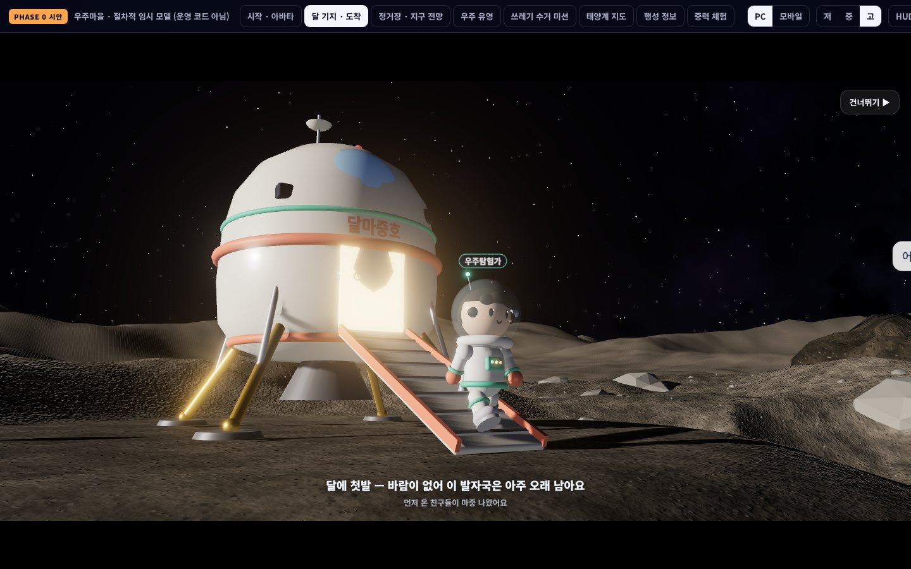

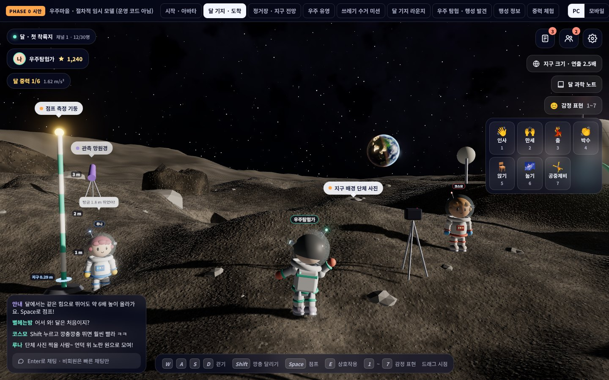

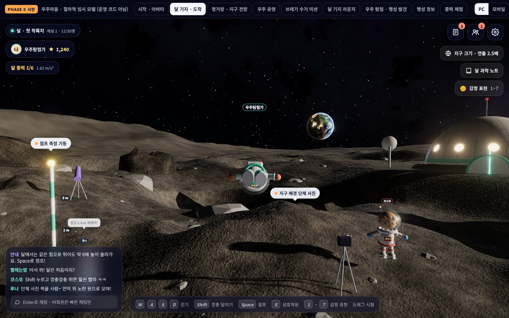

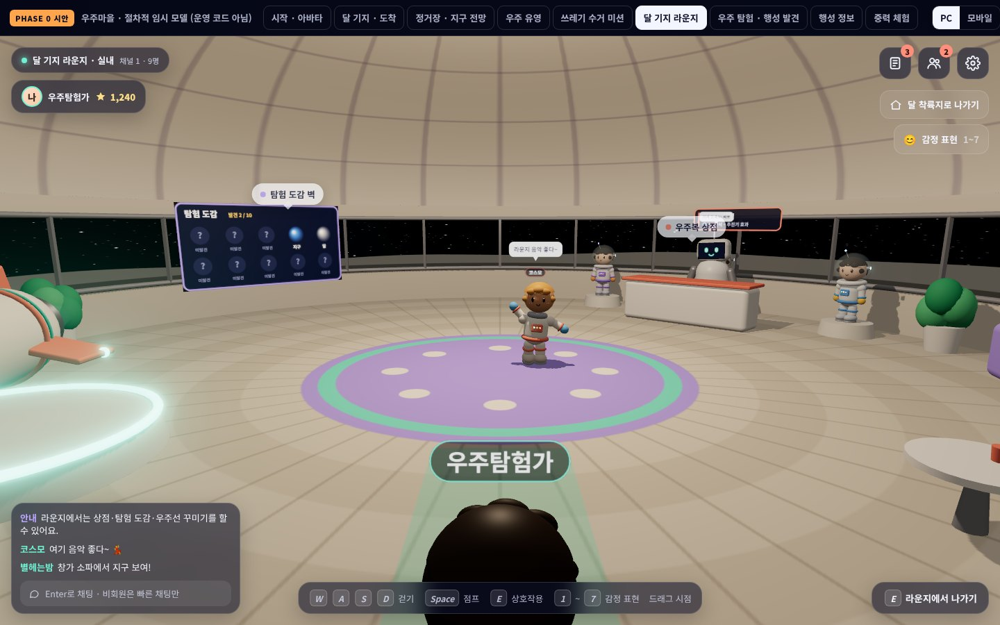

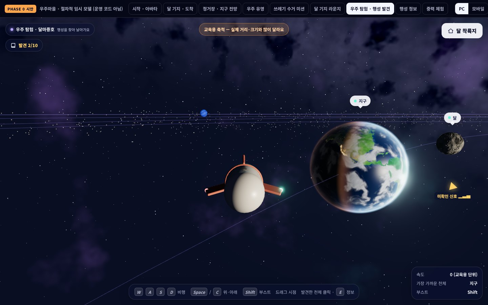

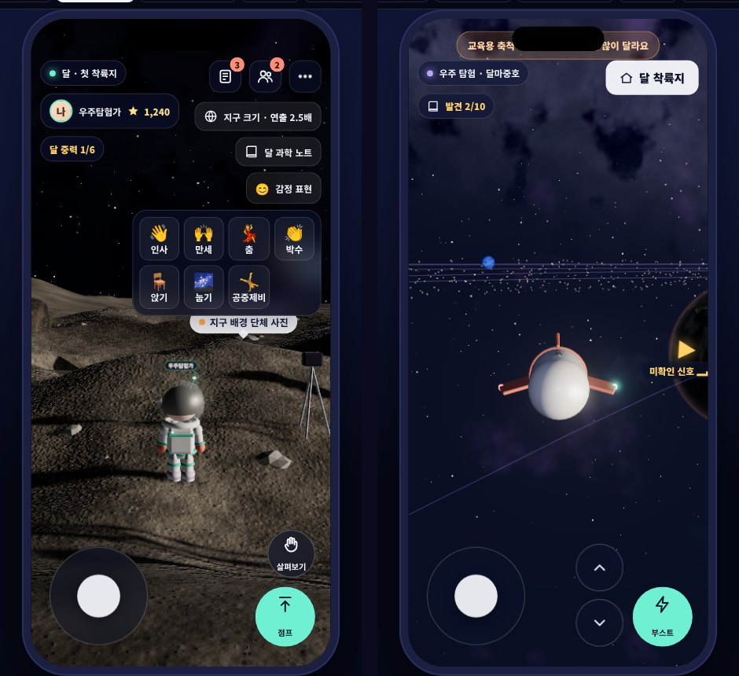

## 12. 기존 멍글마을 에셋 재활용 계획

멍글마을에는 외부 3D 모델·텍스처·이미지 에셋이 없습니다. 사람·강아지·공원은 모두 코드로 만든 모델이라, 재활용 대상은 "코드"입니다. 점검은 `tjdus7911-ops/dog` 저장소 커밋 `13d890d`(2026-11-12)를 읽기 전용으로 받아서 했고, 멍글마을 저장소·서버·데이터는 전혀 바꾸지 않았습니다.

### 권리·라이선스 점검 결과

- **저장소 코드**: LICENSE 파일이 없는 공개 저장소입니다. 별도 라이선스가 없으면 권리는 저작자에게 남아 있습니다. 그래서 저작자 본인이 자기 새 프로젝트에 복사하는 것은 가능합니다. 다른 기여자가 있었다면 그 부분만 따로 동의가 필요합니다.
- **글꼴**: Jua, Gowun Dodum — Google Fonts, OFL. 재사용은 가능하지만, 우주마을은 다른 글꼴을 써서 두 서비스의 인상을 분리하는 것을 권장합니다.
- **라이브러리**: React, Three.js, React Three Fiber, Drei, Zustand, Socket.IO, Express — 모두 MIT라 새로 설치해 씁니다.
- **음원**: 퍼블릭 도메인 곡을 코드로 합성하는 방식입니다(`docs/MUSIC_CREDITS.md`). 우주마을에서는 쓰지 않습니다.
- **브랜드 자산**: 멍글 로고, 아이콘, og.jpg는 재사용하지 않습니다.

### 항목별 재활용 방식

| 요청 항목 | 멍글마을 현황 (파일) | 판정 | 우주마을 적용 |
| --- | --- | --- | --- |
| 3D 사람 아바타 | SD 비율 파츠 조합 빌더, 관절별 메시 병합으로 1인당 약 7번 그리기 (`client/src/game/models/humanModel.ts`, `bake.ts`, `sculpt.ts`, `shared/avatar.ts`) | 구조 재활용 | 관절 이름·파츠 병합·캐시는 그대로. 평면 쉐이딩 로우폴리 재질을 부드러운 스타일라이즈드 재질로 바꾸고, 우주복·헬멧·추진기 파츠 신규 |
| 걷기·대기 애니메이션 | 코드 애니메이션, 이동 거리 기반 보폭으로 발 미끄러짐 방지 (`Human.tsx`) | 재활용 | 정거장 보행에 사용. 무중력 부유·추진 포즈는 신규 |
| 캐릭터 커스터마이징 | 탭별 편집, 옵션별 실제 3D 썸네일 렌더러 (`AvatarEditor.tsx`, `avatarOptions.ts`, `thumbs.ts`) | 구조 재활용 | 썸네일 렌더러·옵션 검증 패턴 재사용. 화면은 우주 테마로 새로 디자인 |
| 채팅 UI | 공간 채팅, 16 m 이내 말풍선 (`ChatPanel.tsx`) + 욕설 필터·도배 방지·요청 제한 (`server/src/moderation.ts`) | 로직 재활용 | 필터·제한 로직은 그대로 복사. UI는 새로 그림 |
| 친구 시스템 | 신청 상태 5종, 개인정보 설정 서버 적용, 함께 산책하기 (`FriendsPanel.tsx`, `realtime.ts`, `db.ts`) | 설계 재활용 | 상태 모델·권한 검사를 PostgreSQL로 다시 구현. "함께 산책" → "친구 따라가기" |
| 3D 카메라·이동 | 3인칭 카메라, 키보드·조이스틱 입력 (`CameraRig.tsx`, `input.ts`, `MobileHud.tsx`) | 재활용 | 정거장 보행에 그대로. 무중력 6방향 이동과 상하 버튼은 신규 |
| 실시간 동기화 | 10 Hz 전송, 140 ms 버퍼 보간, 서버 속도 검증 (`net/remote.ts`, `realtime.ts`) | 재활용 | 수직 좌표와 속도 필드를 추가해 무중력에 맞춤 |
| 공통 버튼·모달·토스트 | `Toasts`, `Modal`, `PanelHeader` (`ui/common.tsx`) | 구조만 | 동작 구조만 참고. 스타일은 우주 테마로 새로 만듦 |
| 관리자 페이지 | 신고 목록·처리, 이용 정지, 승인형 대형 스크린 (`AdminPage.tsx`, `server/src/admin.ts`) | 패턴 재활용 | 권한을 운영자·콘텐츠 담당·최고관리자로 나누고 감사 로그 추가 |
| (추가) 코인 원장 | (사용자, 종류, 고유 ID) UNIQUE로 중복 지급 차단, 잔액 음수 CHECK (`server/src/coins.ts`) | 설계 차용 | 스타코인 거래 테이블에 같은 방식 적용 |
| (추가) 아파트 꾸미기 | 가구 배치·회전·보관·저장 (`Furniture.tsx`, `furniture.ts`, `shared/home.ts`) | 설계 참고 | 개인 우주선 꾸미기의 기본 구조 |
| (추가) PWA | 서비스 워커·매니페스트·설치 안내 (`pwa.ts`, `sw.js`) | 구조 재활용 | 아이콘·이름·캐시 정책 신규 |

### 재활용하지 않는 것

강아지 모델·AI 사진 분석·목줄, 멍글 브랜드, 배포 스크립트(`deploy/`, `render.yaml`), 환경변수·비밀키, 회원·강아지·코인·아파트 데이터는 가져오지 않습니다.

### 복사 절차 (PHASE 1)

1. 멍글마을 저장소를 읽기 전용으로 받습니다. 커밋 해시를 기록합니다.
2. 필요한 파일만 `packages/avatar-kit/` 등에 복사하고, 파일 첫줄에 "멍글마을 dog@커밋에서 복사·개조"를 적습니다.
3. 멍글마을 경로를 import하거나 git submodule로 연결하지 않습니다.
4. `ASSET_PROVENANCE.md`에 출처·커밋·개조 내용·권리 확인일을 표로 남깁니다. 새로 구하는 3D 에셋도 같은 표에 라이선스를 적습니다. 라이선스가 불분명하면 쓰지 않습니다.

## 13. 신규 프로젝트 폴더·기술 구조

저장소는 `tjdus7911-ops/universe` 하나를 모노레포로 씁니다. 클라이언트·서버·관리자 웹은 따로 빌드하고 배포합니다. 멍글마을 경로는 어디에서도 참조하지 않습니다. 이번 PHASE 0에서는 `docs/`와 `prototype/phase0/`만 채웠고, 나머지는 PHASE 1에서 만듭니다.

```
universe/
├─ apps/
│  ├─ web/              # 클라이언트: React + Vite + React Three Fiber (PWA)
│  │  ├─ src/scenes/    # moon · lounge · space · station · eva · mission · planet · gravity · ship
│  │  ├─ src/systems/   # input · camera · walk · zero-g · net(보간)
│  │  ├─ src/hud/       # PC·모바일 HUD, 모달, 토스트
│  │  └─ public/assets/ # glb · ktx2 · 텍스처 (라이선스 기록 필수)
│  ├─ server/           # Node.js + TypeScript: REST + Socket.IO
│  │  ├─ src/rooms/     # 공간·채널 룸, 서버 권위 상태
│  │  ├─ src/modules/   # auth · social · missions · rewards · content · admin
│  │  └─ migrations/    # PostgreSQL 마이그레이션
│  └─ admin/            # 관리자 웹 (별도 빌드·별도 주소)
├─ packages/
│  ├─ shared/           # 프로토콜 타입 · 상수 · 검증 스키마
│  ├─ content/          # 행성 카탈로그 JSON + 출처·검증일
│  └─ avatar-kit/       # 멍글마을에서 복사·개조한 아바타 빌더
├─ prototype/phase0/   # 이번 3D 시안 (독립 실행, 운영 코드 아님)
├─ docs/               # 기획서 Markdown 사본 · 결정 기록
├─ infra/              # 신규 서버 전용 배포·백업 스크립트
└─ .github/workflows/  # 빌드·테스트 CI (배포는 승인 후)
```

### 기술 구성

버전은 2026-11-12 npm 레지스트리의 최신 버전입니다. PHASE 1 시작 때 `package-lock.json`으로 고정합니다.

| 영역 | 선택 | 버전 | 비고 |
| --- | --- | --- | --- |
| UI | React | 19.3 | 멍글마을(18.x)보다 한 단계 위 |
| 빌드 | Vite | 8.3 |  |
| 언어 | TypeScript | 7.0 | 호환 문제가 있으면 6.x로 고정 |
| 3D | Three.js | r187 |  |
| 3D (React) | React Three Fiber / Drei | 9.8 / 10.7 |  |
| 상태 | Zustand | 5.1 |  |
| 실시간 | Socket.IO | 4.8.4 | 서버 권위형 룸 |
| 서버 | Node.js 22 LTS + Express |  | 멍글마을과 같은 패턴, 입력 검증은 스키마 기반 |
| DB | PostgreSQL | 16 이상 | 15장 스키마 |
| 충돌 | 직접 구현한 구·캡슐 충돌 |  | 물리 엔진(Rapier)은 필요할 때만 도입 |
| 3D 에셋 | GLB/glTF + KTX2 텍스처 + meshopt 압축 |  | 코드 조형 모델과 교체 가능한 구조 |

### 3D 에셋 제작 원칙

- 1차는 이번 시안처럼 코드로 조형합니다. 라이선스 문제가 없고 용량이 작습니다.
- 모델을 만드는 함수는 GLB 로더와 같은 관절·부착점 이름을 돌려줍니다. 그래서 나중에 GLB로 바꿔도 애니메이션과 로직은 그대로 작동합니다.
- 외부 에셋은 CC0처럼 상업 이용·수정·재배포가 분명히 허용된 것만 후보로 봅니다. 쓰기 전에 파일별 라이선스 원문을 확인해 출처 표에 기록합니다.
- 지구 텍스처는 퍼블릭 도메인인 Natural Earth 육지 데이터를 래스터화해 직접 만듭니다. npm `world-atlas` 패키지를 쓰며, 이번 시안도 이 방식입니다.

## 14. 시스템 아키텍처

PHASE 1\~3은 서버 없이 로컬 개발과 정적 시안 공개만 합니다. 아래는 PHASE 4부터 쓰는 구조입니다. 처음에는 실시간 서버와 API 서버를 Google Cloud e2-micro 1대에서 함께 돌리고, 부하 테스트(17장) 결과를 보고 나눕니다.

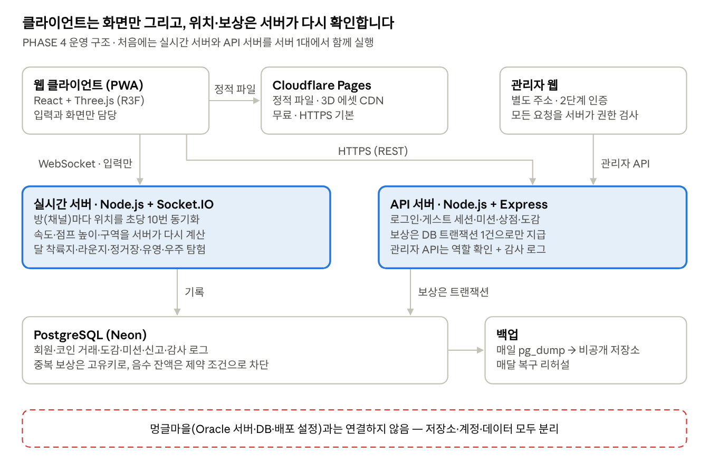

- **서버 권위형**: 클라이언트는 "앞으로 가고 싶다·점프하고 싶다·수거하고 싶다"는 입력만 보냅니다. 위치는 서버가 계산하고, 속도 상한(걷기 1.8 m/s, 깡충 달리기 3.3 m/s, 월면차 5.2 m/s, 우주선 170 게임 단위/초)과 구역(착륙지 50 m, 유영 80 m)을 넘으면 서버 값으로 되돌립니다.
- **점프**: 연속 점프·공중제비는 화면 연출이라 서버는 높이 상한(4단 기준 약 4.1 m)과 체공 시간만 확인합니다.
- **천체 발견·보상**: 서버가 우주선 위치와 천체 거리를 확인한 뒤 planet\_discoveries에 한 번만 기록합니다. 모든 보상은 15장의 트랜잭션 한 건으로만 지급합니다.
- **방(채널)**: 달 착륙지·라운지·정거장·유영 구역·우주 탐험마다 채널을 나누고, 채널 정원은 부하 테스트로 정합니다.
- **관리자**: 관리자 웹은 별도 주소·별도 로그인(2단계 인증)을 씁니다. 모든 관리자 API는 서버가 역할을 확인하고 감사 로그를 남깁니다.
- **멍글마을과 분리**: 저장소·서버·DB·도메인·비밀키·계정이 모두 따로입니다. 멍글마을 Oracle 서버에는 아무것도 배포하지 않습니다.

## 15. 데이터베이스 ERD

우주마을 전용 PostgreSQL을 새로 만듭니다. 멍글마을 DB에는 연결하지 않고, 회원·강아지·코인·아파트 데이터도 가져오지 않습니다. 테이블은 28개이고 여섯 묶음으로 나눴습니다. 개인 기록은 모두 `user_id`로 users에 연결됩니다.

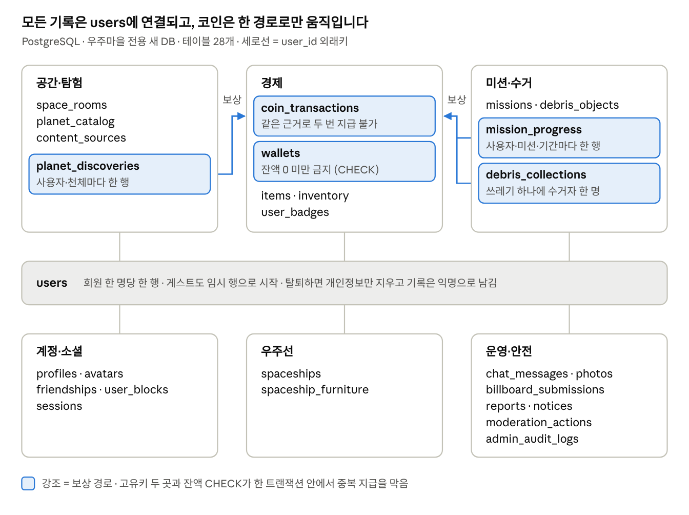

### 공통 규칙

- **기본키**: 사람이 만드는 기록은 시간순 uuid(v7)를, 쌓이기만 하는 기록(코인 거래·채팅·감사 로그)은 `bigint` 자동 증가를 씁니다.
- **시간**: 모든 시각은 `timestamptz`로 저장합니다(UTC로 저장하고 화면에는 한국 시간으로 표시).
- **외래키**: 기본은 `ON DELETE RESTRICT`입니다. 탈퇴하면 행을 지우지 않고 상태를 '탈퇴'로 바꾼 뒤 이메일·닉네임 같은 개인정보만 지웁니다. 그래야 코인 거래와 감사 기록이 어긋나지 않습니다.
- **추가만 하는 표**: coin\_transactions와 admin\_audit\_logs는 앱의 DB 계정에 INSERT·SELECT 권한만 줍니다. 수정·삭제는 할 수 없습니다.
- **서버 값만 저장**: 클라이언트가 보낸 위치·보상 값은 그대로 저장하지 않습니다. 서버가 계산하고 검증한 값만 기록합니다.
- **보관 기간**: 채팅·만료된 세션처럼 오래된 기록은 기간을 정해 자동으로 지웁니다. 기간은 18장의 결정 사항입니다.

### 테이블별 키와 인덱스

**계정·소셜 (6개)**

| 테이블 | 저장하는 것 | 키·제약 | 인덱스 |
| --- | --- | --- | --- |
| users | 회원 1명 = 1행. 역할(player·moderator·admin), 상태, 게스트 여부, 보호자 동의 시각(만 14세 미만 가입을 받을 때) | PK id · UNIQUE email(게스트는 비움) · CHECK role·status 값 | email(부분 고유), status |
| profiles | 닉네임·소개·대표 배지 | PK·FK user\_id (1:1) · UNIQUE lower(nickname) | lower(nickname) |
| avatars | 우주복 프리셋·색·파츠 | PK·FK user\_id (1:1) · 파츠는 보유 아이템만(서버 검사) | — |
| friendships | 친구 요청·수락 | PK (user\_low, user\_high) · CHECK user\_low < user\_high · requested\_by | user\_high, status |
| user\_blocks | 차단(한쪽 방향) | PK (blocker\_id, blocked\_id) · CHECK 자기 자신은 차단 불가 | blocked\_id |
| sessions | 로그인 세션, 갱신 토큰 해시 | PK id · FK user\_id · UNIQUE refresh\_token\_hash | user\_id, expires\_at |

**공간·탐험 (4개)**

| 테이블 | 저장하는 것 | 키·제약 | 인덱스 |
| --- | --- | --- | --- |
| space\_rooms | 공간별 채널(달 착륙지·라운지·정거장·유영·우주 탐험) | PK id · UNIQUE (kind, channel\_no) · capacity = 부하 테스트로 정한 정원 | kind |
| planet\_catalog | 천체 정보와 교육용 축척 값 | PK id('mars' 등) · 모든 수치의 출처 id가 content\_sources에 있어야 함(시드 검사) | — |
| content\_sources | 과학 자료·에셋의 출처, 라이선스, 검증일 | PK id · UNIQUE url · CHECK kind(science·asset) | kind |
| planet\_discoveries | 누가 어떤 천체를 언제 발견했는지 | PK (user\_id, planet\_id) · FK users, planet\_catalog · FK reward\_tx\_id → coin\_transactions | planet\_id |

**미션·수거 (4개)**

| 테이블 | 저장하는 것 | 키·제약 | 인덱스 |
| --- | --- | --- | --- |
| missions | 미션 정의, 보상액, 반복 규칙 | PK id · UNIQUE code · CHECK reward\_coins ≥ 0 · CHECK repeat\_rule(once·daily·weekly) | active\_from, active\_to |
| mission\_progress | 사용자별 진행도와 완료·수령 | PK id · UNIQUE (user\_id, mission\_id, period\_key) · CHECK progress ≤ target | (user\_id, status) |
| debris\_objects | 서버가 띄운 쓰레기 한 개(다시 생기면 새 행) | PK id · FK room\_id · CHECK state(floating·collected) | (room\_id, state) |
| debris\_collections | 누가 어떤 쓰레기를 주웠는지, 서버가 잰 거리 | PK id · UNIQUE debris\_id · FK users, debris\_objects | (user\_id, collected\_at) |

**경제 (5개)**

| 테이블 | 저장하는 것 | 키·제약 | 인덱스 |
| --- | --- | --- | --- |
| wallets | 코인 잔액 | PK·FK user\_id · CHECK balance ≥ 0 | — |
| coin\_transactions | 코인이 움직인 모든 기록(추가만) | PK id · FK user\_id · UNIQUE (user\_id, reason, ref\_type, ref\_id) · CHECK amount ≠ 0 · balance\_after | (user\_id, created\_at) |
| items | 상점 아이템 정의와 가격 | PK id · UNIQUE code · CHECK price ≥ 0 · FK source\_id → content\_sources(에셋 라이선스) | (kind, active) |
| inventory | 보유 아이템과 수량 | PK (user\_id, item\_id) · CHECK qty ≥ 1 · FK acquired\_tx\_id → coin\_transactions | item\_id |
| user\_badges | 받은 배지 | PK (user\_id, badge\_code) | — |

**우주선 (2개)**

| 테이블 | 저장하는 것 | 키·제약 | 인덱스 |
| --- | --- | --- | --- |
| spaceships | 내 우주선 이름·색·선체 | PK id · FK user\_id(처음에는 UNIQUE, 1인 1대) · FK hull\_item\_id → items | user\_id |
| spaceship\_furniture | 우주선 안 가구 배치 | PK id · FK ship\_id, item\_id · 배치 수 ≤ 보유 수량(서버 검사) | ship\_id |

**운영·안전 (7개)**

| 테이블 | 저장하는 것 | 키·제약 | 인덱스 |
| --- | --- | --- | --- |
| chat\_messages | 공간 채팅과 금칙어 필터 결과 | PK id · FK room\_id, sender\_id · CHECK 길이 | (room\_id, created\_at) |
| photos | 기념사진 기록(파일 저장 위치는 PHASE 4에서 결정) | PK id · FK user\_id · CHECK visibility | (user\_id, created\_at) |
| billboard\_submissions | 전광판 게시 신청과 승인 | PK id · FK user\_id, reviewed\_by · CHECK status | (status, created\_at) |
| reports | 신고 | PK id · FK reporter\_id · UNIQUE (reporter\_id, target\_type, target\_id) | (status, created\_at) |
| moderation\_actions | 경고·채팅 금지·이용 정지 | PK id · FK target\_user\_id, actor\_id, report\_id | (target\_user\_id, created\_at) |
| notices | 공지 | PK id · FK created\_by · CHECK starts\_at < ends\_at | starts\_at |
| admin\_audit\_logs | 관리자가 한 모든 일과 변경 전·후 값(추가만) | PK id · FK actor\_id | (actor\_id, created\_at), (target\_type, target\_id) |

### 중복 보상 방지

- 보상액은 클라이언트가 보내지 않습니다. 서버가 missions와 planet\_catalog에서 읽습니다.
- 지급은 항상 트랜잭션 하나로 처리합니다. 근거 행 추가 → 지갑 행 잠금 → 거래 행 추가 → 잔액 갱신 → 커밋 순서이며, 중간에 하나라도 실패하면 전부 취소됩니다.
- 같은 요청이 두 번 와도(두 번 클릭, 네트워크 재전송, 두 기기 동시 접속) 근거 행이나 거래 행의 고유키에 막혀 두 번째는 지급되지 않습니다.
- 구매는 `balance >= 가격` 조건을 건 UPDATE로 잔액을 줄입니다. 잔액이 모자라면 바뀌는 행이 0개라 구매가 실패합니다. CHECK (balance ≥ 0)는 마지막 안전장치입니다.
- 구매 요청마다 클라이언트가 주문 id(uuid)를 만들어 보내고, 서버는 그 id를 ref\_id로 저장합니다. 같은 주문이 다시 와도 한 번만 처리됩니다.
- 매일 밤 wallets 잔액과 coin\_transactions 합계를 맞춰 보고, 다르면 관리자에게 알립니다.

```sql
-- 천체 발견 보상: 서버가 거리 검증을 마친 뒤 실행
-- $1 사용자 id, $2 천체 id, $3 보상액(서버가 planet_catalog에서 읽음)
BEGIN;

-- ① 근거 기록: 이미 발견했다면 0행 → ROLLBACK, 보상 없음
INSERT INTO planet_discoveries (user_id, planet_id, discovered_at)
VALUES ($1, $2, now())
ON CONFLICT (user_id, planet_id) DO NOTHING
RETURNING planet_id;

-- ② 지갑 잠금: 같은 사용자의 다른 지급·구매와 순서를 맞춤
SELECT balance FROM wallets WHERE user_id = $1 FOR UPDATE;

-- ③ 거래 기록: UNIQUE (user_id, reason, ref_type, ref_id)가 두 번째 지급을 막음
INSERT INTO coin_transactions (user_id, amount, reason, ref_type, ref_id, balance_after)
VALUES ($1, $3, 'discovery', 'planet', $2,
        (SELECT balance FROM wallets WHERE user_id = $1) + $3)
RETURNING id;

-- ④ 잔액 갱신, 근거 행에 ③의 거래 id($4) 연결
UPDATE wallets SET balance = balance + $3, updated_at = now() WHERE user_id = $1;
UPDATE planet_discoveries SET reward_tx_id = $4
 WHERE user_id = $1 AND planet_id = $2;

COMMIT;
```

## 16. 단계별 개발 계획과 예상 작업량

PHASE 1\~6 전체는 약 63\~86 작업일로 예상합니다. 작업일은 1인 개발자가 AI 코딩 도구와 하루 6시간 안팎으로 작업하는 기준입니다. 각 PHASE 끝에는 승인 점검을 둡니다. 승인에서는 "구현함"과 "실기기에서 테스트함"을 따로 보고합니다.

| PHASE | 범위 | 예상 작업량 | 완료 기준 |
| --- | --- | --- | --- |
| 0 기획·시안 | 이 문서, 3D 시안, 저장소 구조 | 완료 (승인 대기) | 시안 승인 |
| 1 핵심 3D 체험 | 시작 화면, 아바타·우주복, 출발·달 착륙 연출, 달 착륙지(저중력 보행·연속 점프·발자국·먼지·감정 표현), 라운지 입장, 정거장·지구 전망, 무중력 유영, 복귀, PC·모바일 조작, 품질 설정 | 13\~17일 | 달 착륙지 입장·점프, 라운지 출입, 정거장에서 지구가 보임, 유영 가능, 모바일 정상 작동. 중급 휴대폰 30 fps 이상, 첫 진입 다운로드 10 MB 이하 목표 |
| 2 행성 교육 | 우주 탐험(비행·천체 발견), 3D 행성 관측, 행성 정보, 지구·달·화성 중력 비교, 망치·깃털 실험, 퀴즈, 도감 | 7\~10일 | 9개 천체 정보 출처·검증일 완비, 중력 계산 자동 테스트 통과 |
| 3 게임 시스템 | 서버·DB 최초 구성, 쓰레기 수거, 일일 미션, 스타코인, 보상 내역, 배지 | 8\~11일 | 중복·음수·조작 요청 테스트 통과, 재접속 후 유지 |
| 4 소셜 시스템 | 회원가입·로그인, 게스트 세션, 친구, 채팅, 실시간 동기화, 채널, 친구 따라가기, 신고·차단, 부하 테스트 | 12\~16일 | 봇 20·30·50명 부하 테스트 결과로 채널 정원 확정 |
| 5 꾸미기·운영 | 개인 우주선, 가구 배치·저장, 라운지 상점 구매, 광고판, 관리자 페이지, 신고 관리, 감사 로그 | 10\~14일 | 관리자 API 권한 테스트 통과, 미승인 광고 노출 0건 |
| 6 QA·출시 준비 | 호환성·성능·동기화·보안 점검, 백업 복구 리허설, 개인정보 처리방침 | 7\~10일 | 백업에서 실제 복구 성공, 키워드 취약점 점검 완료 |
| 병행 트랙 | 행성·쓰레기 교육 문구, 퀴즈, 출처 검증, 3D 모델 다듬기 | 6\~8일 | 문구마다 출처 링크, 에셋마다 라이선스 기록 |

PHASE 3에서 코인·도감을 서버에 저장하려면 계정이 필요합니다. 그런데 회원가입은 PHASE 4입니다. 그래서 PHASE 3은 개발용 임시 계정으로 서버 API를 먼저 완성하고, PHASE 4에서 정식 계정에 연결합니다.

## 17. 서버 비용과 무료 운영 가능성

PHASE 0\~3은 0원으로 진행할 수 있습니다. 하지만 "무료만으로 30명 상시 멀티플레이"는 보장할 수 없습니다. PHASE 4의 무료 후보는 Google Cloud e2-micro + Neon Free + Cloudflare Pages 조합입니다. 공개 운영에 필요한 유료 자원은 부하 테스트 결과와 견적을 보고한 뒤 승인을 받고 만듭니다. 이번 단계에서는 어떤 서버·계정도 만들지 않았고 결제도 하지 않았습니다. 표의 조건은 2026-11-12에 확인한 것이며 업체가 예고 없이 바꿀 수 있습니다.

### 실시간 서버 후보

| 후보 | 무료 조건·기간 | CPU·메모리 | 저장 공간 | 네트워크 | 동시 접속 예상 (미측정 추정) | 한도 초과 시 | 장기 위험 | 판정 |
| --- | --- | --- | --- | --- | --- | --- | --- | --- |
| [Google Cloud e2-micro](https://cloud.google.com/free/docs/compute-getting-started) | Always Free, 기한 없음. 미국 3개 리전만, 카드 등록 | e2-micro 1대 (메모리 1 GB) | 표준 디스크 30 GB | 북미에서 나가는 트래픽 월 1 GB | 채널 1개, 20명 안팎 | 초과 트래픽 종량 과금 | 메모리·트래픽이 작고, 미국 리전이라 한국에서 지연이 큼 | **PHASE 4 무료 후보** |
| [Koyeb Free](https://www.koyeb.com/docs/reference/instances) | 조직당 1개 | 0.1 vCPU · 512 MB | SSD 2 GB | 명시 없음 | 수 명 | 유료 인스턴스 | 1시간 트래픽이 없으면 잠듦. 2026년 Mistral AI 인수, 카드 홀드 도입 보도 | 대안 |
| [Oracle Always Free](https://developer.oracle.com/free.html) (멍글마을과 같은 계정) | Always Free. 1인 1계정, 카드 등록 | A1 합계 2 OCPU·12 GB([2026년 절반으로 축소](https://linuxiac.com/?p=214114)) + AMD 1/8 OCPU·1 GB VM 2대 | 블록 볼륨 합계 200 GB | 월 10 TB | A1을 쓸 수 있다면 수십 명 이상. AMD VM은 수 명 | A1 한도를 넘기면 계정의 A1 인스턴스 전부 비활성화 | 멍글마을 배포 문서는 A1 2 OCPU·12 GB를 쓰도록 되어 있어 A1 여유가 없음. 실수 하나로 멍글마을이 멈출 수 있음 | **비추천** (분리 원칙) |
| [Render Free](https://render.com/docs/free) | 워크스페이스당 월 750시간 | 512 MB | 임시 파일시스템 (재시작 시 삭제) | 월 100 GB(보도) | 상시 월드 불가 | 유료 인스턴스 월 7달러부터 | 15분간 요청·WebSocket 메시지가 없으면 잠들고 깨어나는 데 약 1분. 무료 Postgres는 30일 후 만료 | 비추천 |
| [Railway](https://railway.com/pricing) | 30일 체험 5달러 크레딧 후 월 1달러 크레딧 | 서비스당 1 vCPU · 0.5 GB | 볼륨 0.5 GB | 종량 | 월 1달러 안에서는 상시 가동 어려움 | Hobby 월 5달러부터 | 크레딧 소진 시 중단 | 비추천 |
| [Fly.io](https://fly.io/docs/about/discontinued-plans/) | 신규 조직은 무료 없음. 체험은 2시간 또는 7일([요약](https://temps.sh/blog/fly-io-pricing-2026)) | 종량 | 종량 | 종량 | — | 종량 과금 | 무료 불가 | 제외 |
| [AWS Free plan](https://aws.amazon.com/free) | 최대 200달러 크레딧, 최대 6개월 | 크레딧 범위 | 크레딧 범위 | 크레딧 범위 | — | 유료 플랜 전환 필요 | 기간이 끝나면 계정 종료 | 제외 |
| [Cloudflare Durable Objects](https://developers.cloudflare.com/durable-objects/platform/pricing) | Workers Free 플랜, SQLite 방식만 | 요청당 CPU 제한 | 객체당 1 GB([FAQ](https://developers.cloudflare.com/durable-objects/reference/faq)) | — | 하루 요청 10만 건 = 10 Hz 기준 하루 약 2.8 플레이어·시간 | 다음 날까지 오류 | Socket.IO를 쓸 수 없어 서버를 다시 짜야 함 | 제외 |

### DB·프런트 후보

| 후보 | 무료 조건 | 용량·연산 | 네트워크 | 장기 위험 | 판정 |
| --- | --- | --- | --- | --- | --- |
| [Neon Free](https://neon.com/faqs/free-plan-limits-and-quotas) (PostgreSQL) | 카드 불필요, 기한 없음 | 프로젝트당 1 GB, 월 100 CU-시간, 최대 2 CU | 프로젝트당 월 5 GB | 5분 미사용 시 일시 정지(끌 수 없음), 한도를 넘기면 쓰기 실패 | **추천** |
| [Supabase Free](https://www.jetadmin.io/blog/supabase-pricing-2026-guide-to-plans-limits-and-real-world-costs/) | 활성 프로젝트 2개 | DB 500 MB | 월 5 GB | 1주일 동안 활동이 없으면 프로젝트 일시 정지 | 대안 |
| [Cloudflare Pages](https://developers.cloudflare.com/pages/platform/limits) (프런트·3D 에셋) | 기한 없음 | 사이트당 파일 20,000개, 파일당 25 MiB, 월 빌드 500회 | 정적 파일 대역폭 무제한(보도) | 대용량 비HTML 파일을 과도하게 올리면 약관 제재 가능 | **추천** |

### 트래픽 추정 (계산, 미측정)

위치 동기화는 서버가 초당 10번, 각 플레이어에게 나머지 사람들의 상태를 보내는 방식입니다. 상태 1개를 24바이트 이진 형식으로 줄이면, 30명 채널 하나가 서버에서 내보내는 트래픽은 시간당 약 0.78 GB입니다. JSON으로 보내면 약 2.2 GB가 됩니다. 10명이 하루 2시간씩 쓰면 이진 형식 기준 월 약 5 GB로, e2-micro 무료량 1 GB를 넘습니다. 그래서 이진 프로토콜, 멀리 있는 플레이어는 전송 빈도를 낮추기, 정지 시 전송 생략을 처음부터 넣습니다.

```latex
\text{egress/s} = N \times \left( (N-1) \times B + 30 \right) \times 10
```

N은 채널 인원, B는 플레이어 상태 1개의 바이트 수, 30은 메시지당 평균 부가 바이트로 잡은 가정치입니다.

### 단계별 권장안

| 단계 | 구성 | 예상 비용 | 비고 |
| --- | --- | --- | --- |
| PHASE 0\~3 | 로컬 개발 + 시안 공개는 Claude 아티팩트 또는 Cloudflare Pages | 0원 | 새 계정 없이 진행 가능 |
| PHASE 4 멀티플레이 검증 | Cloudflare Pages + e2-micro(Node·Socket.IO) + Neon Free | 0원 목표. 테스트 트래픽이 1 GB를 넘으면 소액 과금 가능 | GCP 계정 생성·카드 등록은 승인 후. 예산 알림 1달러 설정 |
| 공개 운영 | 한국·일본 리전 소형 유료 VM 또는 PaaS 유료 플랜 | 부하 테스트 후 견적 | 결제는 사전 승인 필수 |

### 부하 테스트 계획 (PHASE 4)

- Socket.IO 봇이 초당 10번 이동하고 30초에 한 번 채팅합니다. 인원을 10 → 20 → 30 → 50명으로 올리며 측정합니다.
- 측정: CPU·메모리, 이벤트 루프 지연 p95, 틱 처리 시간, 플레이어·시간당 트래픽, 클라이언트 지연 p95.
- 통과 기준(초안): 이벤트 루프 지연 p95 20 ms 미만, CPU 70% 미만, 10분 연속 메모리 증가 없음. 통과한 최대 인원의 80%를 채널 정원으로 정합니다.

### 운영 필수 항목

- **HTTPS**: Cloudflare Pages는 기본 제공합니다. 서버는 Let's Encrypt 자동 갱신을 씁니다.
- **도메인**: 처음에는 무료 `*.pages.dev` 주소를 씁니다. 전용 도메인 구입은 유료라 승인 후 진행합니다.
- **백업·복구**: 매일 `pg_dump`로 우주마을 전용 비공개 저장소에 암호화 백업을 남깁니다. 매달 빈 DB에 복구하는 리허설도 합니다.
- **로그·오류 모니터링**: 서버는 구조화 로그와 헬스 체크를 두고, 클라이언트 오류는 무료 플랜이 있는 도구를 PHASE 4에서 고릅니다. 무료 한도는 선택 때 확인합니다.
- **관리자 보호**: 관리자 웹은 별도 주소에 둡니다. 관리자 계정에는 2단계 인증(OTP)을 걸고, 모든 관리자 요청은 서버에서 권한을 확인한 뒤 감사 로그를 남깁니다.

## 18. 구현·테스트 현황과 승인 요청 사항

이번 PHASE 0에서 만든 것은 이 기획서와 직접 조작해 볼 수 있는 3D 시안입니다. 시안은 화면과 조작감을 판단하기 위한 것이고, 서버·DB·로그인·멀티플레이는 아직 없습니다. 아래 표는 구현과 테스트를 나눠 적었습니다. 테스트 칸의 '헤드리스 크롬'은 화면 없는 크롬에서 빌드 결과를 열고, 키 입력 스크립트로 움직이며 화면을 찍어 확인했다는 뜻입니다.

### 시안 기능별 현황

| 기능 | 구현 | 테스트 | 메모 |
| --- | --- | --- | --- |
| 시작 화면 · 게스트로 시작 | 시안 | 헤드리스 크롬 | 로그인·회원가입 없음 |
| 달 착륙 연출(약 10초) | 시안 | 헤드리스 크롬 | 건너뛰기 버튼 있음 |
| 달 착륙지 지형·지구·별 | 시안 | 헤드리스 크롬 | 지구는 기본이 연출 크기(실제의 2.5배), 버튼으로 실제 크기 |
| 걷기·깡충 달리기·점프(달 중력 1.62 m/s²) | 시안 | 헤드리스 크롬 | 손맛은 실제 기기에서 확인해야 함 |
| 연속 점프 4단·공중제비 | 시안 | 헤드리스 크롬 | 높이 배율은 '게임 보너스'로 표시 |
| 감정 표현 7가지 | 시안 | 헤드리스 크롬 | 숫자 1\~7 또는 버튼 |
| 월면차·망원경·단체 사진·망치와 깃털·중력 비교 | 시안 | 헤드리스 크롬 |  |
| 달 기지 라운지(입장·상점·도감 벽·소파) | 시안 | 헤드리스 크롬 | 상점은 가진 우주복 적용만. 새 아이템 구매는 PHASE 3 |
| 우주 탐험(가까이 가면 발견, 클릭하면 정보) | 시안 | 헤드리스 크롬 | 새로고침하면 발견 기록이 처음(지구·달)으로 돌아감 |
| 행성 정보 화면 | 시안 | 헤드리스 크롬 | 발견한 천체만 넘겨 보기 |
| 정거장(탑승장에서 달·우주 탐험으로 출발)·우주 유영·쓰레기 수거 미션·중력 체험 | 시안 | 헤드리스 크롬 |  |
| PC·모바일 화면 배치 | 시안 | 헤드리스 크롬(화면 크기를 바꿔 촬영) | 실제 휴대폰·터치는 확인 안 함 |
| 다른 사람과 함께 움직이기(멀티플레이) | 안 함 | — | 지금 보이는 4명은 움직임을 미리 짠 NPC. PHASE 4 |
| 로그인·DB·코인 저장 | 안 함 | — | PHASE 1\~4. 설계는 14·15장 |
| 서버의 위치·보상 검증 | 설계만 | — | 14·15장 |
| 부하 테스트(30명·100명) | 안 함 | — | PHASE 4에 무료 서버에서 측정해 보고 |
| 프레임 성능 | 측정 안 함 | — | 헤드리스 크롬은 소프트웨어 렌더링이라 성능 근거가 되지 못함 |

### 확인하지 못한 것

- 실제 그래픽카드에서의 프레임과 발열
- 실제 휴대폰(iOS Safari·Android Chrome)에서의 터치 조작
- 소리(이번 시안에는 소리가 없음)
- 여러 사람이 동시에 접속했을 때의 동작

### 승인 요청 사항

1. 이 시안의 흐름(달 착륙 → 달 착륙지 → 라운지 → 우주 탐험·정거장)으로 PHASE 1을 시작해도 될까요?
2. 지구는 연출 크기(실제의 2.5배)를 기본으로 두고, 버튼으로 실제 크기를 보여 주는 방식이 괜찮을까요?
3. 연속 점프의 높이 보너스(최대 ×1.52)를 유지할까요? 화면에는 '게임 보너스 — 실제로는 같은 힘이면 높이가 같아요'를 계속 표시합니다.
4. 운영 버전은 13장대로 React + React Three Fiber로 새로 만들고, 이번 시안 코드는 참고용으로만 쓸까요?
5. 만 14세 미만 이용자의 가입을 받을까요? 받는다면 보호자 동의 절차를 PHASE 1 범위에 넣어야 합니다.
6. 보관 기간을 채팅 30일, 만료된 세션 7일, 관리자 감사 로그 1년으로 정해도 될까요?
7. 서비스 이름 '우주마을'(가칭)을 확정할까요?

PHASE 4의 무료 서버 계정(Google Cloud·Neon·Cloudflare)은 그때 다시 승인을 받은 뒤 만듭니다. 이번 단계에서는 어떤 서버·계정도 만들지 않았고 결제도 하지 않았습니다.

## 19. 출처

기획서의 수치와 판단에 쓴 자료입니다. 따로 적지 않은 것은 2026-11-12에 확인했습니다.

### 과학 자료

- [NASA NSSDCA Planetary Fact Sheet](https://nssdc.gsfc.nasa.gov/planetary/factsheet/index.html) — 행성 수치의 기본 출처
- [NASA Sun Fact Sheet](https://nssdc.gsfc.nasa.gov/planetary/factsheet/sunfact.html) · [Earth Fact Sheet](https://nssdc.gsfc.nasa.gov/planetary/factsheet/earthfact.html) · [Moon Fact Sheet](https://nssdc.gsfc.nasa.gov/planetary/factsheet/moonfact.html) · [Mars Fact Sheet](https://nssdc.gsfc.nasa.gov/planetary/factsheet/marsfact.html)
- [NASA LRO 달 표면 온도 자료(PDF)](https://science.nasa.gov/wp-content/uploads/2024/01/lrolitho7temperaturevariation27may2014.pdf)
- [NASA Mercury Facts](https://science.nasa.gov/mercury/facts)
- [NASA NSSDCA — 아폴로 15호 망치와 깃털 실험](https://nssdc.gsfc.nasa.gov/planetary/lunar/apollo_15_feather_drop.html)
- [NASA — 달의 조석 고정](https://science.nasa.gov/moon/tidal-locking/)
- [The Planetary Society — 우주 사진에 별이 보이지 않는 이유](https://www.planetary.org/articles/why-are-there-no-stars)
- [Space.com — 달에 남은 발자국](https://www.space.com/35352-eugene-cernan-moon-legacy-footprints.html)
- [SwRI 보도자료 — 웹 망원경이 찾은 천왕성의 29번째 위성(2025-08-19)](https://www.eurekalert.org/news-releases/1095256)
- [ESA 우주 환경 통계](https://sdup.esoc.esa.int/discosweb/statistics/) · [ESA Space Environment Report 2026](https://www.esa.int/Space_Safety/Space_Debris/ESA_Space_Environment_Report_2026)

### 시안에 쓴 코드·데이터

- [three.js](https://github.com/mrdoob/three.js) 0.187 — MIT
- [Vite](https://github.com/vitejs/vite) 8.3 — MIT(개발 도구)
- [world-atlas](https://github.com/topojson/world-atlas) 2.0.2 — ISC. 원본은 퍼블릭 도메인인 [Natural Earth](https://www.naturalearthdata.com/)이며 지구 육지 텍스처에 씀
- [topojson-client](https://github.com/topojson/topojson-client) 3.1.0 — ISC
- [webgl-noise(Ashima Arts·Stefan Gustavson)](https://github.com/ashima/webgl-noise) — MIT. 달 지형·행성 셰이더의 노이즈
- 우주인·착륙선·월면차·라운지 같은 3D 모델과 나머지 텍스처는 이번 시안에서 코드로 직접 만들었습니다. 멍글마을 파일은 복사하지 않았고, 우주인 관절 이름만 멍글마을 아바타와 같은 규칙으로 맞췄습니다.

### 서버·DB 비용

- [Google Cloud 무료 등급 — e2-micro](https://cloud.google.com/free/docs/compute-getting-started)
- [Koyeb 인스턴스](https://www.koyeb.com/docs/reference/instances)
- [Oracle Cloud Always Free](https://developer.oracle.com/free.html) · [linuxiac — A1 무료 한도 축소 보도](https://linuxiac.com/?p=214114)
- [Render 무료 플랜](https://render.com/docs/free)
- [Railway 요금](https://railway.com/pricing)
- [Fly.io 중단된 플랜](https://fly.io/docs/about/discontinued-plans/) · [temps.sh — Fly.io 요금 요약](https://temps.sh/blog/fly-io-pricing-2026)
- [AWS 프리 티어](https://aws.amazon.com/free)
- [Cloudflare Durable Objects 요금](https://developers.cloudflare.com/durable-objects/platform/pricing) · [FAQ](https://developers.cloudflare.com/durable-objects/reference/faq)
- [Neon 무료 플랜 한도](https://neon.com/faqs/free-plan-limits-and-quotas)
- [Jetadmin — Supabase 요금 정리(2026)](https://www.jetadmin.io/blog/supabase-pricing-2026-guide-to-plans-limits-and-real-world-costs/)
- [Cloudflare Pages 한도](https://developers.cloudflare.com/pages/platform/limits)
